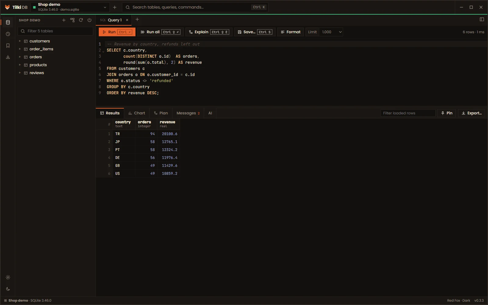
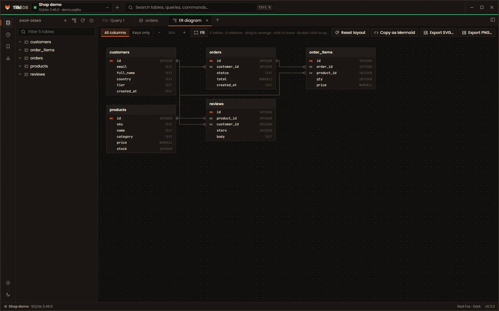
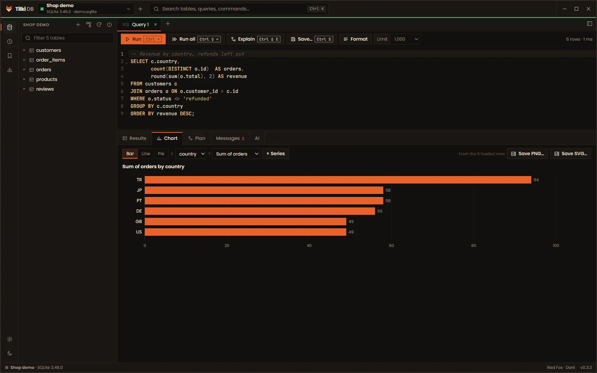

<p align="center">
  
</p>

<h1 align="center">Tilki DB</h1>

<p align="center">
  A fast, keyboard-first SQL client for <b>PostgreSQL</b>, <b>MySQL</b>, <b>MariaDB</b> and <b>SQLite</b>.<br>
  Built with Rust and Tauri. A 7 MB installer, not a bundled browser.
</p>

<p align="center">
  <a href="../../releases/latest"><b>Download for Windows</b></a> ·
  <a href="https://bilenahmet.com/tilkidb">Website</a> ·
  <a href="https://bilenahmet.com/tilkidb/support">Support</a>
</p>

<p align="center">
  
</p>

## Why it is fast

Most desktop database tools ship a full copy of Chromium and Node.js. Tilki DB doesn't.

- **Rust core.** Connections, queries, dumps, imports and SSH tunnels run in native async Rust ([sqlx](https://github.com/launchbadge/sqlx) on tokio). No Node process sits in between.
- **Tauri 2 shell.** The UI runs in the WebView the OS already has. The Windows installer is about **7 MB**, against the 100 MB+ typical of Electron apps.
- **Rows stream in.** Results flow from Rust to the grid in batches over a Tauri channel, so the first rows show while the rest are still arriving. A query never has to fit in memory as one big JSON blob.
- **A virtual grid.** Only the rows on screen are drawn, so scrolling through hundreds of thousands of rows stays smooth.
- **Cancel any time.** A running query can be stopped without freezing the window.

## Features

**Querying**
- SQL editor with schema-aware autocomplete, JOIN hints, formatting and inline error markers
- Several result sets per run, pinned results and side-by-side comparison
- Query parameters, `EXPLAIN` plan view, history and saved queries
- Per-tab sessions, so `USE`, `SET` and transactions stay in their own tab
- Notebooks that mix Markdown and SQL

**Tables**
- Edit cells in place with typed editors, a foreign-key picker, paste and bulk set
- Header filters, "referenced by" navigation, duplicate rows and sample data
- Structure editing: columns, indexes, triggers and DDL
- Charts on any result or table: bar, line and pie, exported to PNG or SVG

**Tools**
- ER diagrams with orthogonal routing
- Schema compare and data compare between two connections
- Copy tables across connections, even across engines
- SQL dump and restore; CSV, JSON and XLSX import and export
- Users and roles, server activity, sessions and locks

**Safety**
- Passwords and API keys live in the OS keychain, never in files
- Connections marked _production_ ask before running destructive SQL
- Read-only connections, SSH tunnels and optional auto-reconnect
- An optional AI assistant that uses your own Anthropic API key

<p align="center">
  
  
</p>

## Install

Download the latest installer from [Releases](../../releases/latest) and run it. It installs per user and needs no admin rights. After that the app updates itself from the same page; installing a new version over an old one keeps your connections and settings.

Windows is supported today. macOS and Linux builds are planned.

## Build from source

You need Node 22+, Rust (MSVC toolchain on Windows) and the Visual Studio C++ build tools.

```powershell
cd app
npm install
npm run tauri dev      # desktop window with hot reload
npm test               # frontend unit tests
cargo test --manifest-path src-tauri/Cargo.toml
```

More detail in [app/README.md](app/README.md).

## Contributing

Bug reports, ideas and pull requests are welcome. Read [CONTRIBUTING.md](CONTRIBUTING.md) before you open a pull request.

## License

Tilki DB is **source-available**, not open source.

- **The official builds** on the [Releases](../../releases/latest) page are free for anyone to use, including at work. See [BINARY-LICENSE.md](BINARY-LICENSE.md).
- **The source code** is under the [PolyForm Strict License 1.0.0](LICENSE). You can read it and build it for noncommercial use, and change it to contribute back. You may not redistribute, republish or sell it or anything based on it, under this name or any other.
- **Contributions** are accepted under the [Contributor License Agreement](CLA.md).

"Tilki DB" and the fox logo are trademarks of the author.
